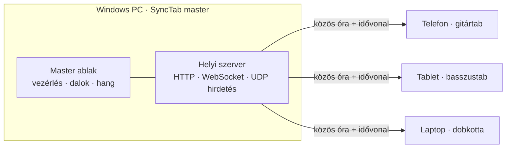

<div align="center">

# SyncTab

**Egy dal, minden eszköz, mindenki a saját szólamát látja.**

Szinkronizált tab megjelenítő zenekaroknak. Töltsd be a Guitar Pro fájlt egy számítógépen, és a vele azonos Wi-Fi-n lévő
minden telefon, tablet vagy laptop a *saját* hangszerének tabját mutatja, a zenét követő vonallal – internet, fiók és
telepítés nélkül a többi eszközön.

[](LICENSE)


%20seg%C3%ADts%C3%A9g%C3%A9vel-8A63D2)

[**Letöltés**](../../releases/latest) · [Gyors kezdés](#gyors-kezdés) · [Működés](#működés) · [Nyelvek](#nyelvek) · [Fordítás forrásból](#fordítás-forrásból) · [MI-vel készült](#mi-vel-készült) · *[English](README.md)*


</div>

---

## Tartalom

- [Funkciók](#funkciók)
- [Gyors kezdés](#gyors-kezdés)
- [Használat](#használat)
- [Android alkalmazás](#android-alkalmazás)
- [Működés](#működés)
- [Szinkron pontossága](#szinkron-pontossága)
- [Nyelvek](#nyelvek)
- [Fordítás forrásból](#fordítás-forrásból)
- [Hibaelhárítás](#hibaelhárítás)
- [Állapot és korlátok](#állapot-és-korlátok)
- [MI-vel készült](#mi-vel-készült)
- [Közreműködés](#közreműködés)
- [Licenc](#licenc)

## Funkciók

- **Hangszerenként külön tab minden eszközön.** A master betölt egy Guitar Pro dalt (`.gp`, `.gp3`, `.gp4`, `.gp5`, `.gpx`);
  minden eszköz a saját sávját (gitár, basszus, dob, …) mutatja tabként, kottaként vagy mindkettőként. A dobsávok
  automatikusan dobkottát kapnak.
- **A zenét követő vonal**, amely minden eszközön együtt halad – lásd [Szinkron pontossága](#szinkron-pontossága).
- **Csak helyi hálózaton működik.** Nem kell internet, felhőszolgáltatás vagy fiók.
- **A többi eszközön semmit sem kell telepíteni:** elég egy weboldalt megnyitni (QR-kóddal), vagy használható az
  [Android-alkalmazás](#android-alkalmazás), ami magától megtalálja a mastert.
- **Opcionális hang minden eszközön.** Bármennyi sáv bepipálható, egy sáv szólózható, a hangerő állítható. A tempóváltás
  (25–150 %) a hanggal együtt is működik. Az eszközök alapból némák.
- **Metronóm** eszközönként, öt hanggal (kattintás, fahang, kolomp, hi-hat, csipogás) és külön hangerővel.
- **Beszámolás** (ki / 1 ütem / 2 ütem) a masteren állítva. Minden eszközön megjelenik a számolás, a zene pontosan a végén indul.
- **Master vezérlők:** lejátszás / szünet (Szóköz), megállítás (Home), tempó, ismétlés, ugrás a tabra kattintással,
  sávonkénti némítás és szóló, nagyítás, világos és sötét téma.
- **16 nyelv**, és egy kis JSON fájl szerkesztésével [saját nyelv](docs/LANGUAGES.md) is hozzáadható – újraépítés nélkül.
- **A dalok a te gépeden maradnak.** Csak a mastert futtató gép tölthet be dalt vagy vezérelheti a lejátszást.

## Gyors kezdés

1. **Töltsd le** a telepítőt (`SyncTab-Setup-<verzió>.exe`) a [legújabb kiadásból](../../releases/latest), és futtasd.
   A Windows „SmartScreen" figyelmeztetést mutathat, mert a telepítő nincs kódaláírva – válaszd a *További információ →
   Futtatás mindenképp* lehetőséget.
2. **Indítsd el a SyncTabot.** Az első indításkor a Windows tűzfal rákérdez, engedélyezed-e a hálózaton – **engedélyezd**,
   különben a többi eszköz nem tud csatlakozni.
3. **Adj hozzá egy dalt:** húzz egy Guitar Pro fájlt az ablakba (vagy *Fájlok hozzáadása…*). Kipróbáláshoz ott a
   mellékelt [`examples/synctab-demo.gp`](examples/synctab-demo.gp).
4. **Csatlakoztasd a többi eszközt** (ugyanazon a Wi-Fi-n): olvasd be a QR-kódot a master bal oldali paneljén, vagy gépeld
   be az alatta látható címet egy böngészőbe. Androidon használhatod az [alkalmazást](#android-alkalmazás) is.
5. Minden eszközön add meg a neved, koppints a **Csatlakozás** gombra, és a felső legördülő listából válaszd ki a hangszered.
6. Nyomj **Lejátszást** (vagy Szóközt) a masteren. 🎸

<p align="center">
  
</p>

> **Tipp – honnan szerzek tabot?** Bármilyen Guitar Pro fájl jó, például a saját átiratod, vagy olyan fájl, amit egy
> tabokat kínáló oldalról jogosan használhatsz. Kérlek, tartsd tiszteletben annak az oldalnak a feltételeit és a szerzői jogokat.

## Használat

### A masteren (Windows)

| | |
|---|---|
| **Lejátszás / Szünet** | a gomb, vagy <kbd>Szóköz</kbd> |
| **Megállítás** | a ⏹ gomb, vagy <kbd>Home</kbd> |
| **Ugrás** | kattints egy ütemre a tabon |
| **Tempó** | csúszka, 25 % – 150 % |
| **Ismétlés** | a dal ismétlése |
| **Beszámolás** | ki / 1 ütem / 2 ütem – minden eszközön látszik, a lejátszás a végén indul. Újabb lejátszás-nyomás megszakítja |
| **Metronóm** | be / ki, hang és hangerő (ennek a gépnek a hangszóróján) |
| **Hang** | a master saját hangját némítja vagy engedélyezi; a sávonkénti **M** / **S** gomb némít vagy szólóz (a **👁** gomb a masteren mutatott sávot választja) |
| **Dalok** | húzz be `.gp` fájlokat, kattints egy dalra a betöltéshez, a ✕ töröl |
| **Csatlakozás** | QR-kód és cím; ha a gépnek több hálózati címe van, válaszd ki a Wi-Fi-n lévőt |
| **Szinkron** | óraszinkron állapota és a *Hangkésés korrekció* a finomhangoláshoz (lásd lent) |

### A többi eszközön (böngésző vagy Android-alkalmazás)

- **Sáv legördülő lista** (felső sáv): válaszd ki a hangszered. A SyncTab megjegyzi a következő dalhoz.
- **A− / A+**: szövegméret. **⚙**: beállítások.
- **⚙ → Hang bekapcsolása**: pipáld be, mely sávokat akarod hallani, az **S** gombbal szólózz; állítsd a hangerőt.
- **⚙ → Metronóm / Beszámolás hangja**: eszközönkénti kattogás, saját hanggal és hangerővel. A beszámolás hangja alapból ki
  van kapcsolva, hogy egy teremnyi telefon ne kattogjon egyszerre.
- **⚙ → Időzítés korrekció**: ha a vonal vagy a kattintás ezen az eszközön korán vagy későn érzed (például Bluetooth
  fülhallgatóval), told el néhány ezredmásodperccel.
- **⚙ → Nézet / Téma / Nyelv**: tab, kotta + tab vagy kotta; világos vagy sötét; a felület nyelve.

<p align="center">
  
</p>

## Android alkalmazás

Az [`android/`](android) mappa egy kis alkalmazást tartalmaz, amely a megjelenítőt teljes képernyős WebView-ban mutatja,
és ébren tartja a képernyőt. Magától megtalálja a mastert (a master UDP-n, a `41234`-es porton hirdeti magát a Wi-Fi-n),
vagy megadható a cím.

<p align="center">
  
  &nbsp;&nbsp;
  
</p>

- Telepítsd a `SyncTab-<verzió>.apk` fájlt a [legújabb kiadásból](../../releases/latest) (Android 8.0+): másold a
  telefonra és nyisd meg (engedélyezni kell az ismeretlen forrásból való telepítést), vagy használd az `adb install -r` parancsot.
- Az APK debug kulccsal van aláírva, oldalról való telepítésre való, a Play Áruházba nem.
- Ha a Wi-Fi tiltja a szórást (vendég-hálózat, „kliens-izoláció"), gépeld be a master ablakban látható címet.
- A vissza gomb vagy a **⚙ → Másik master kiválasztása** a csatlakozó képernyőre visz vissza.

Az alkalmazás nem kötelező: a megjelenítő egyszerű weboldal, böngészőben is működik. Az alkalmazás az automatikus
keresést, a teljes képernyőt és az ébren maradó képernyőt adja.

## Működés



A SyncTab egy [Electron](https://www.electronjs.org/) alkalmazás. A master ablak egy helyi webszervert tartalmaz, a
megjelenítők az általa kiszolgált egyszerű weboldalak. A tabot az [alphaTab](https://www.alphatab.net/) rajzolja és játssza le.

A nehéz feladat az, hogy mindenki *együtt* legyen. A „játssz most" vagy „ugorj ide" parancsok eszközönként kicsit másképp
érkeznek meg, ezért a SyncTab helyette **közös órát** és **idővonalat** használ:

- **Közös óra.** Minden eszköz NTP-szerűen méri az óraeltérését a szerverhez: sok ping/pong, és a legkisebb késésű minták
  számítanak. Innentől mindenki ugyanazt a „szerveridőt" látja.
- **Idővonal.** A master a lejátszó *hallható* pozíciójából horgonyt közöl: „a zene *X* ms-nál tart a *Y* szerveridőben".
  Minden megjelenítő ebből számolja ki minden képkockán a pozíciót. Nincs ugrálás, és a hálózati késés nem számít.
- **A megjelenítőknek nem kell szintetizátor a vonalhoz.** Az alphaTab „külső időforrás" módban fut, a vonalat a kiszámolt
  idő mozgatja, így a telefonok nem melegszenek és gyorsak maradnak.
- **Metronóm és beszámolás.** Minden eszköz a dalból számolja az ütésrácsot, és a szerveridő alapján előre, a hangkártya
  órájára ütemezi a kattanásokat, így mindenhol ugyanabban a pillanatban szólnak. A master megméri a lejátszás gomb és a
  hallható indulás közti időt, és ennyivel korábban indítja a zenét, így a zene pontosan a beszámolás végén kezdődik.
- **A hangkimenet késését** (Bluetooth esetén nagy) a böngésző által jelentett érték alapján kompenzáljuk. Ami marad, azt a
  korrekciós csúszkákkal kézzel lehet hangolni.
- **Opcionális hang a megjelenítőkön.** Egy láthatatlan, élő szintetizátor szólaltatja meg a kiválasztott sávokat,
  ugyanahhoz az idővonalhoz igazítva; 25 ms-nál nagyobb elcsúszásnál magától újrapozicionál.

## Szinkron pontossága

Automatizált tesztekkel mérve, ahol a master és a megjelenítők **ugyanazon a gépen** futnak (így közös valódi rendszeróra
szolgál független mércéül):

| Eset | A megjelenítő vonala a master hallható pozíciójához képest |
|---|---|
| Normál lejátszás, 100 % és 50 % tempó, ugrás után | kb. 1–3 ms-on belül |
| Hálózat szimulált, mindkét irányban véletlenszerű 5–40 ms késéssel | kb. ±6 ms-on belül |
| Metronóm kattanások, master és megjelenítő | kb. 1–9 ms-on belül |
| Beszámolás vége → zene kezdete | nagyjából 20 ms-on belül, ha az indulási késés már mért (az indítás utáni első lejátszás kevésbé pontos) |
| Opcionális hang a megjelenítőn a master hangjához képest | nagyjából −3 … −18 ms |

Ezek **próbapados számok, nem garanciák**. Valódi telefonokon és valódi Wi-Fi-n az eredmény függ az adott eszköz
hanghardverétől (főleg Bluetooth esetén), és attól is, hogy a Wi-Fi az egyik irányban jobban késleltet-e a másiknál – ezt egy
óraszinkron nem tudja észlelni. Ezért vannak a korrekciós csúszkák.

## Nyelvek

Az alapértelmezett nyelv az angol. A felület a böngésző vagy a telefon nyelvét követi, ha van hozzá fordítás, és a
masteren, illetve minden eszközön a nyelvmenüből váltható.

English · Magyar · Deutsch · Español · Français · Italiano · Nederlands · Polski · Português · Türkçe · Русский ·
简体中文 · 日本語 · 한국어 · हिन्दी · العربية (jobbról balra)

Új nyelvhez elég egy szövegszerkesztő: másold le a [`public/lang/en.json`](public/lang/en.json) fájlt, fordítsd le az értékeket,
told be a saját nyelvi mappába (`%APPDATA%\SyncTab\lang`), és válaszd ki a menüből – újraépítés nélkül. Ellenőrzés:
`npm run check-lang`. Részletek: **[docs/LANGUAGES.md](docs/LANGUAGES.md)** (angolul).

> A fordítások MI-vel készültek, anyanyelvi beszélő nem nézte át őket. A javításokat nagyon szívesen fogadjuk.

## Fordítás forrásból

[Node.js](https://nodejs.org/) 20 vagy újabb kell (Node 24-gyel fejlesztve).

```bash
git clone https://github.com/<neved>/synctab.git
cd synctab
npm install
npm start          # elindítja a master alkalmazást
npm run dist       # a Windows telepítőt a dist/ mappába építi
npm run check-lang # a nyelvi fájlokat ellenőrzi
```

> Ha az `npm start` ezzel a hibával áll meg: `Cannot read properties of undefined (reading 'requestSingleInstanceLock')`,
> a terminálban be van állítva az `ELECTRON_RUN_AS_NODE` (a VS Code terminálja néha beállítja). Töröld, és próbáld újra.

### Android alkalmazás

JDK (17 vagy újabb) és Android SDK kell (platform 35 / build-tools; a Gradle letölti, amire szüksége van).
Hozd létre az `android/local.properties` fájlt `sdk.dir=<az Android SDK útvonala>` tartalommal, majd:

```bash
cd android
./gradlew assembleDebug        # Windowson: gradlew.bat assembleDebug
```

Az APK az `android/app/build/outputs/apk/debug/app-debug.apk` helyen keletkezik.

### Projekt felépítése

```
src/            Electron fő folyamat és a helyi szerver (Express + WebSocket + UDP hirdetés)
public/         master és megjelenítő oldalak (HTML/JS/CSS), i18n, hangmotor
public/lang/    nyelvi fájlok (az en.json az alap)
android/        Android WebView alkalmazás (Kotlin), saját lokalizált szövegekkel
docs/           dokumentáció és képek
examples/       demódal a kipróbáláshoz
tools/          segédszkriptek (nyelvi fájl ellenőrző)
```

## Hibaelhárítás

| Probléma | Mit érdemes tenni |
|---|---|
| A többi eszköz nem éri el az oldalt | Engedélyezd a SyncTabot a Windows tűzfalban (privát hálózatok). Gondoskodj róla, hogy az eszközök **ugyanazon a Wi-Fi-n** legyenek, mint a gép. |
| A QR-kód rossz címet nyit meg | A gépnek több hálózati címe van (VPN, virtuális adapterek). A *Csatlakozás* panelen válaszd ki a Wi-Fi-n lévőt. |
| Az Android-alkalmazás nem találja a mastert | Néhány Wi-Fi tiltja a szórást (vendég-hálózat, kliens-izoláció). Add meg a címet kézzel. |
| Nincs hang a telefonon | A böngészők csak koppintás után engednek hangot: előbb koppints a *Csatlakozás*ra, majd kapcsold be a hangot a ⚙-ben. Nézd meg a telefon hangerejét. |
| A vonal vagy a kattanás egy eszközön kicsit korán/későn jön | Használd az eszköz ⚙ paneljén az *Időzítés korrekció*t (Bluetooth fülhallgatónál jellemző). A masteren a *Hangkésés korrekció*t. |
| A telefon képernyője kikapcsol | A böngészők egyszerű `http://` címen nem tudják ébren tartani a képernyőt. Használd az Android-alkalmazást, vagy állítsd a telefon képernyő-időkorlátját. |
| A Windows „ismeretlen közzétevőt" jelez | A telepítő nincs kódaláírva. *További információ → Futtatás mindenképp*. |

## Állapot és korlátok

A SyncTab fiatal projekt. Kérlek, éles fellépés előtt olvasd el ezt.

- Automatizált böngészős tesztekkel, szimulált hálózati ingadozással és Android-emulátorral próbáltuk ki. **Valódi
  telefonokon, valódi Wi-Fi hálózatokon és valódi hangszórókon kevés tesztelés történt.**
- A master **csak Windowson** készül és tesztelt. A kód többplatformos Electron, macOS-en vagy Linuxon megfelelő
  építéssel akár működhet is, de ezt nem próbáltuk ki.
- A megjelenítőket Chromium-alapú böngészőkben és az Android WebView-ban teszteltük. A Safari (iPhone/iPad) és a Firefox
  nincs tesztelve.
- A megjelenítő oldalak sima HTTP-t használnak a helyi hálózaton, és **nincs bejelentkezés**: bárki megnyithatja, aki
  ugyanazon a hálózaton van és ismeri a címet. Dalt betölteni és lejátszást vezérelni csak a mastert futtató gép tud.
- A telepítő és az APK nincs közzétevői tanúsítvánnyal aláírva.
- A tárolóban még nincs automatizált tesztcsomag.

## MI-vel készült

**Ezt a projektet MI-asszisztens segítségével terveztük és írtuk.** Az ötlet, a követelmények és a döntések emberi
részről jönnek; a kódot, a fordításokat, a teszteket és ezt a dokumentációt a [Claude](https://www.anthropic.com/claude)
(az Anthropic MI-modellje) készítette, a [Claude Code](https://claude.com/claude-code)-on keresztül, interaktívan.

Mit jelent ez neked:

- A kódot futtatással ellenőriztük – automatizált böngészős tesztek, szimulált hálózati körülmények, Android-emulátor –,
  de **formális emberi kódátnézés vagy biztonsági audit nem volt**. Kérlek, nézd át, mielőtt fontos dologra rábíznád.
- A fordítások gépiek, anyanyelvi beszélő nem nézte át őket.
- A hibajelentéseket és a javító pull requesteket szívesen fogadjuk.

## Közreműködés

Issue-kat és pull requesteket szívesen fogadunk – különösen valódi eszközökről és hálózatokról érkező hibajelentéseket és
fordítás-javításokat. Fordításnál a [`public/lang/`](public/lang) mappa fájlját szerkeszd, és a pull request előtt futtasd
az `npm run check-lang` parancsot. Lásd: [docs/LANGUAGES.md](docs/LANGUAGES.md).

## Licenc

A SyncTab nyílt forráskódú, az [MIT licenc](LICENSE) alatt. Harmadik felek komponenseit azok saját licencei alatt használja,
lásd [THIRD_PARTY_NOTICES.md](THIRD_PARTY_NOTICES.md) (különösen az [alphaTab](https://www.alphatab.net/), MPL-2.0).
