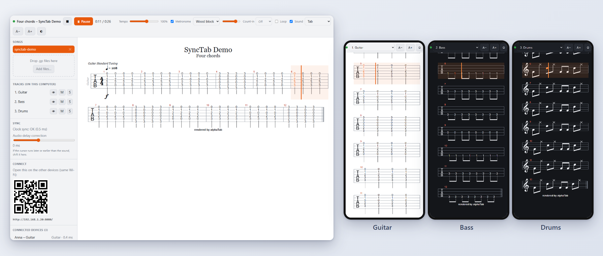
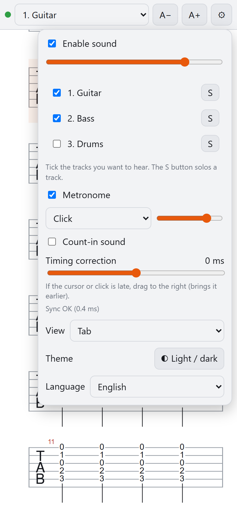
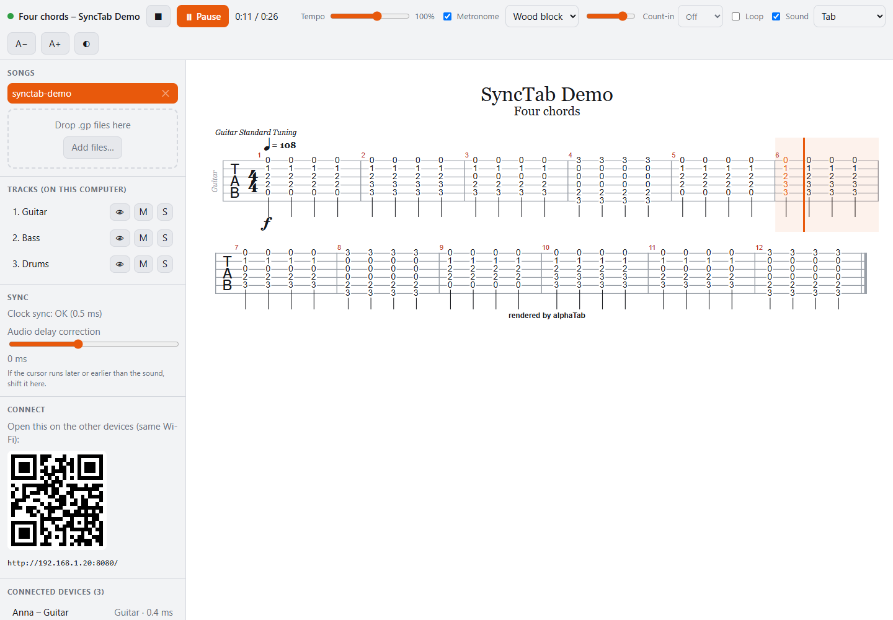
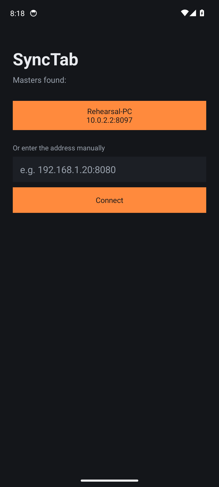
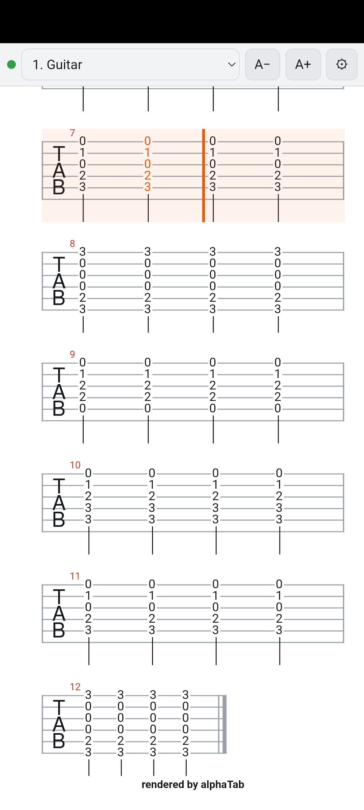
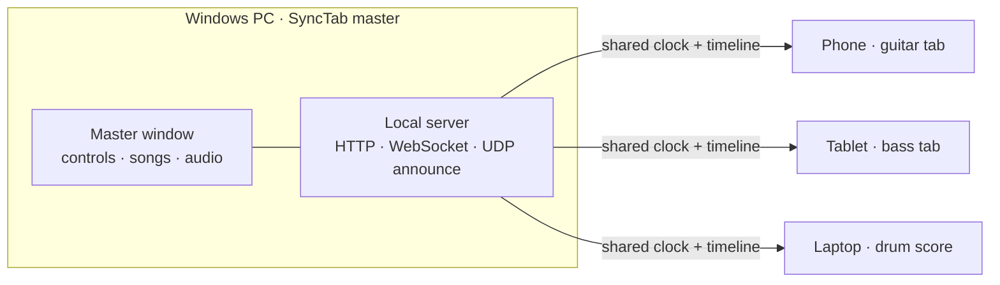

<div align="center">

# SyncTab

**One song, every device, each musician sees their own part.**

A synchronized tab viewer for bands. Load a Guitar Pro file on one computer, and every phone, tablet or laptop on the
same Wi-Fi shows the tab of *its own* instrument with a cursor that follows the music – no internet, no accounts,
nothing to install on the other devices.

[](LICENSE)


-8A63D2)

[**Download**](../../releases/latest) · [Quick start](#quick-start) · [How it works](#how-it-works) · [Languages](#languages) · [Build from source](#build-from-source) · [Built with AI](#built-with-ai) · *[Magyarul](README.hu.md)*



</div>

---

## Contents

- [Features](#features)
- [Quick start](#quick-start)
- [Using SyncTab](#using-synctab)
- [Android app](#android-app)
- [How it works](#how-it-works)
- [Synchronization accuracy](#synchronization-accuracy)
- [Languages](#languages)
- [Build from source](#build-from-source)
- [Troubleshooting](#troubleshooting)
- [Status and limitations](#status-and-limitations)
- [Built with AI](#built-with-ai)
- [Contributing](#contributing)
- [License](#license)

## Features

- **Per-instrument tabs on every device.** The master loads a Guitar Pro song (`.gp`, `.gp3`, `.gp4`, `.gp5`, `.gpx`);
  each device picks its own track (guitar, bass, drums, …) and shows it as tab, score, or both. Drum tracks automatically
  use drum notation.
- **A cursor that follows the music**, kept in step on all devices – see [Synchronization accuracy](#synchronization-accuracy).
- **Works on a local network only.** No internet connection, cloud service or account is needed.
- **Nothing to install on the other devices:** open a web page (scan the QR code) or use the [Android app](#android-app),
  which finds the master by itself.
- **Optional sound on every device.** Tick any tracks you want to hear, solo a track, set the volume. Tempo changes
  (25–150 %) work with sound too. Devices are silent by default.
- **Metronome** per device, with five sounds (click, wood block, cowbell, hi-hat, beep) and its own volume.
- **Count-in** (off / 1 bar / 2 bars) set on the master. Every device shows the count; the music starts exactly at its end.
- **Master controls:** play / pause (Space), stop (Home), tempo, loop, click on the tab to jump, per-track mute and solo,
  zoom, light and dark theme.
- **16 languages**, and you can [add your own](docs/LANGUAGES.md) by editing a small JSON file – no rebuild needed.
- **Songs stay on your computer.** Only the machine running the master can load songs or control playback.

## Quick start

1. **Download** the installer (`SyncTab-Setup-<version>.exe`) from the [latest release](../../releases/latest) and run it.
   Windows may show a "SmartScreen" warning because the installer is not code-signed – choose *More info → Run anyway*.
2. **Start SyncTab.** The first time, Windows Firewall asks whether to allow it on your network – **allow it**, or the
   other devices cannot connect.
3. **Add a song:** drag a Guitar Pro file into the window (or *Add files…*). New to this? Try the included
   [`examples/synctab-demo.gp`](examples/synctab-demo.gp).
4. **Connect the other devices** (same Wi-Fi): scan the QR code in the master's left panel, or type the address shown below
   it into a browser. On Android you can use the [app](#android-app) instead.
5. On each device enter a name, tap **Join**, and choose your instrument from the drop-down at the top.
6. Press **Play** (or Space) on the master. 🎸

<p align="center">
  
</p>

> **Tip – where do I get tabs?** Any Guitar Pro file works, for example your own transcriptions, or files you are allowed
> to use from a tab site. Please respect the terms and copyright of wherever you download tabs from.

## Using SyncTab

### On the master (Windows)

| | |
|---|---|
| **Play / Pause** | the button, or <kbd>Space</kbd> |
| **Stop** | the ⏹ button, or <kbd>Home</kbd> |
| **Jump** | click a bar in the tab |
| **Tempo** | slider, 25 % – 150 % |
| **Loop** | repeats the song |
| **Count-in** | off / 1 bar / 2 bars – shown on all devices; playback starts when it ends. Press play again to cancel |
| **Metronome** | on / off, sound and volume (this computer's speakers) |
| **Sound** | mutes or enables the master's own audio; **M** / **S** buttons per track mute or solo (the **👁** button picks the track shown on the master) |
| **Songs** | drag `.gp` files in, click a song to load it, ✕ deletes it |
| **Connect** | QR code and address; if the PC has several network addresses, pick the one on your Wi-Fi |
| **Sync** | clock-sync status, and *Audio delay correction* for fine-tuning (see below) |

### On the other devices (browser or Android app)

- **Track drop-down** (top bar): choose your instrument. SyncTab remembers it for the next song.
- **A− / A+**: text size. **⚙**: settings.
- **⚙ → Enable sound**: tick the tracks you want to hear and use **S** to solo; adjust the volume.
- **⚙ → Metronome / Count-in sound**: per-device click, with its own sound and volume. Count-in sound is off by default so
  that a room full of phones does not click at once.
- **⚙ → Timing correction**: if the cursor or click feels early or late on *this* device (for example with Bluetooth
  headphones), shift it by a few milliseconds.
- **⚙ → View / Theme / Language**: tab, score + tab or score; light or dark; interface language.

<p align="center">
  
</p>

## Android app

The [`android/`](android) folder contains a small app that wraps the viewer in a full-screen WebView and keeps the screen
awake. It finds the master automatically (the master announces itself on the Wi-Fi via UDP, port `41234`), or you can
type the address.

<p align="center">
  
  &nbsp;&nbsp;
  
</p>

- Install `SyncTab-<version>.apk` from the [latest release](../../releases/latest) (Android 8.0+): copy it to the phone and
  open it, allowing installs from unknown sources, or use `adb install -r`.
- The APK is signed with a debug key. It is meant for sideloading, not for the Play Store.
- If your Wi-Fi blocks broadcasts (guest networks, "client isolation"), type the address shown in the master window.
- Back button or **⚙ → Choose another master** returns to the connect screen.

You do not need the app: the viewer is an ordinary web page and works in a browser too. The app adds automatic discovery,
full-screen mode and a screen that stays on.

## How it works



SyncTab is an [Electron](https://www.electronjs.org/) app. The master window contains a local web server; the viewers are
plain web pages served by it. Tabs are rendered and played by [alphaTab](https://www.alphatab.net/).

The hard part is keeping everyone *together*. Instead of sending "play now" or "jump here" commands, which arrive at
slightly different times on each device, SyncTab shares a **clock** and a **timeline**:

- **Shared clock.** Every device measures its clock offset to the server NTP-style: many ping/pong round trips, using the
  samples with the lowest delay. From then on everyone agrees on one "server time".
- **Timeline.** The master publishes an anchor – "the music is at *X* ms at server time *Y*" – using its *audible*
  playback position. Each viewer works out the current position from that anchor on every frame. There are no jumps, and
  network delay does not matter.
- **Viewers don't need a synthesizer to show the cursor.** alphaTab runs in "external media" mode and the cursor is driven
  by the computed time, so phones stay cool and responsive.
- **Metronome and count-in.** Each device derives the beat grid from the song and schedules clicks ahead of time on the
  sound card's clock using server time, so they sound at the same moment everywhere. The master measures the delay between
  pressing play and the audible start, and starts the music that much earlier, so the music begins exactly at the end of
  the count-in.
- **Audio output latency** (large with Bluetooth) is compensated using what the browser reports. What remains can be
  tuned by hand with the correction sliders.
- **Optional sound on viewers.** A hidden live synthesizer plays the chosen tracks, aligned to the same timeline; it
  repositions itself if it drifts by more than 25 ms.

## Synchronization accuracy

Measured with automated tests where the master and viewers run on the **same PC** (so they share one real system clock
that can serve as an independent reference):

| Scenario | Viewer cursor vs. master's audible position |
|---|---|
| Normal playback, tempo 100 % and 50 %, after a jump | within about 1–3 ms |
| Network with simulated 5–40 ms random delay in both directions | within about ±6 ms |
| Metronome clicks, master vs. viewer | within about 1–9 ms |
| Count-in end → music start | within roughly 20 ms once the start delay has been measured (the first play after launch is less exact) |
| Optional sound on a viewer vs. the master's sound | roughly −3 … −18 ms |

These are **test-bench numbers, not guarantees**. On real phones and real Wi-Fi the result also depends on each device's
audio hardware (especially Bluetooth) and on whether the Wi-Fi delays one direction more than the other – a clock sync
cannot detect that. That is why the correction sliders exist.

## Languages

English is the default. The interface follows your browser or phone language when a translation exists, and can be changed
from the language menu on the master and on every device.

English · Magyar · Deutsch · Español · Français · Italiano · Nederlands · Polski · Português · Türkçe · Русский ·
简体中文 · 日本語 · 한국어 · हिन्दी · العربية (right-to-left)

Adding a language takes a text editor: copy [`public/lang/en.json`](public/lang/en.json), translate the values, drop the file
into the custom language folder (`%APPDATA%\SyncTab\lang`) and pick it from the menu – no rebuild. Check it with
`npm run check-lang`. Details in **[docs/LANGUAGES.md](docs/LANGUAGES.md)**.

> The translations were produced with AI and have not been reviewed by native speakers. Corrections are very welcome.

## Build from source

You need [Node.js](https://nodejs.org/) 20 or newer (developed with Node 24).

```bash
git clone https://github.com/<your-name>/synctab.git
cd synctab
npm install
npm start          # runs the master app
npm run dist       # builds the Windows installer into dist/
npm run check-lang # validates the language files
```

> If `npm start` fails with `Cannot read properties of undefined (reading 'requestSingleInstanceLock')`, your terminal has
> `ELECTRON_RUN_AS_NODE` set (VS Code terminals sometimes do). Unset it and try again.

### Android app

Requires a JDK (17 or newer) and the Android SDK (platform 35 / build-tools; Gradle downloads what it needs).
Create `android/local.properties` containing `sdk.dir=<path to your Android SDK>`, then:

```bash
cd android
./gradlew assembleDebug        # Windows: gradlew.bat assembleDebug
```

The APK is written to `android/app/build/outputs/apk/debug/app-debug.apk`.

### Project layout

```
src/            Electron main process and the local server (Express + WebSocket + UDP announce)
public/         master and viewer pages (HTML/JS/CSS), i18n, audio engine
public/lang/    language files (en.json is the base)
android/        Android WebView app (Kotlin) with its own localized strings
docs/           documentation and images
examples/       a demo song to try things out
tools/          helper scripts (language file checker)
```

## Troubleshooting

| Problem | What to try |
|---|---|
| Other devices cannot open the page | Allow SyncTab in Windows Firewall (private networks). Make sure the devices are on the **same Wi-Fi** as the PC. |
| The QR code opens the wrong address | The PC has several network addresses (VPN, virtual adapters). Select the one on your Wi-Fi in the *Connect* panel. |
| The Android app does not find the master | Some Wi-Fi networks block broadcasts (guest networks, client isolation). Type the address manually. |
| No sound on a phone | Browsers only allow sound after a tap: tap *Join* first, then enable sound in ⚙. Check the phone's volume. |
| Cursor or clicks feel slightly early/late on one device | Use *Timing correction* in that device's ⚙ panel (typical with Bluetooth headphones). On the master use *Audio delay correction*. |
| The screen of a phone turns off | Browsers cannot keep the screen awake on plain `http://`. Use the Android app, or change the phone's screen timeout. |
| Windows says "unknown publisher" | The installer is not code-signed. *More info → Run anyway*. |

## Status and limitations

SyncTab is a young project. Please read this before relying on it for a live gig.

- It has been exercised with automated browser tests, simulated network jitter and an Android emulator. It has had **little
  testing on real phones, real Wi-Fi networks and real speakers.**
- The master is built and tested on **Windows only**. The code is cross-platform Electron and might work on macOS or Linux
  with an appropriate build, but that is untested.
- Viewers were tested in Chromium-based browsers and the Android WebView. Safari (iPhone/iPad) and Firefox are untested.
- The viewer pages use plain HTTP on your local network and have **no login**: anyone on the same network who knows the
  address can open the viewer. Only the computer running the master can load songs or control playback.
- The installer and APK are not signed with a publisher certificate.
- There is no automated test suite in the repository yet.

## Built with AI

**This project was designed and written with the help of an AI assistant.** The idea, the requirements and the decisions
come from a human; the code, the translations, the tests and this documentation were produced by
[Claude](https://www.anthropic.com/claude) (an AI model by Anthropic), working interactively through
[Claude Code](https://claude.com/claude-code).

What that means for you:

- The code was checked by running it – automated browser tests, simulated network conditions, an Android emulator – but it
  has **not had a formal human code review or a security audit**. Please review it before trusting it with anything
  important.
- The translations are machine-made and unreviewed by native speakers.
- Bug reports and pull requests that improve any of this are welcome.

## Contributing

Issues and pull requests are welcome – especially bug reports from real devices and networks, and corrections to
translations. For a translation, edit the file in [`public/lang/`](public/lang) and run `npm run check-lang` before
opening the pull request. See [docs/LANGUAGES.md](docs/LANGUAGES.md).

## License

SyncTab is open source under the [MIT License](LICENSE). It uses third-party components under their own licenses – see
[THIRD_PARTY_NOTICES.md](THIRD_PARTY_NOTICES.md) (notably [alphaTab](https://www.alphatab.net/), MPL-2.0).
